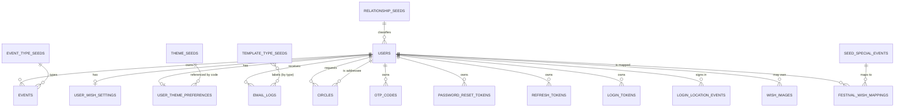
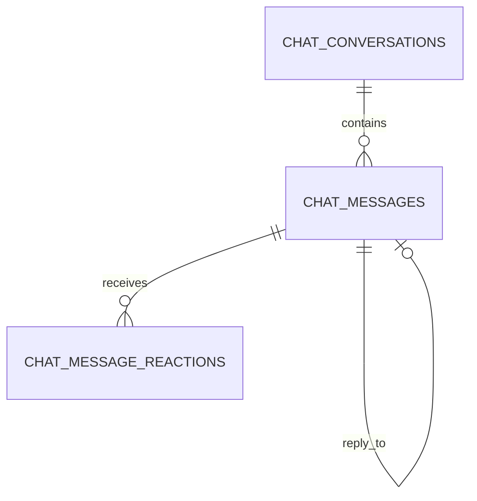

# Entity-relationship diagram

## 1. Primary database



### 1.1 ASCII overview

```
relationship_seeds 1 ── * users
                        │
                        ├── 1 ── * events ── * ── 1 event_type_seeds
                        ├── 1 ── 1 user_wish_settings
                        ├── 1 ── 1 user_theme_preferences ── (code) ── theme_seeds
                        ├── 1 ── * email_logs
                        ├── 1 ── * circles (requester_id)
                        ├── 1 ── * circles (addressee_id)
                        ├── 1 ── * otp_codes
                        ├── 1 ── * password_reset_tokens
                        ├── 1 ── * refresh_tokens
                        ├── 1 ── * login_tokens
                        ├── 1 ── * login_location_events
                        ├── 1 ── * wish_images (user_id nullable = everyone)
                        └── 1 ── * festival_wish_mappings ── * ── 1 seed_special_events

standalone: violated_users, notifications, instagram_user, message_log,
            template_type_seeds, relationship_seeds, event_type_seeds, theme_seeds
```

## 2. Chat database



`user_a_id` / `user_b_id` / `sender_id` / `receiver_id` reference `users.id` in the **primary**
database. There is no cross-database foreign key; referential integrity for these columns is the
application's responsibility.

## 3. Cardinalities and participation

| Relationship | Cardinality | Optional? | Notes |
| --- | --- | --- | --- |
| User → wish settings | 1 : 1 | Settings row created with the user | Cascade `ALL` from `User` |
| User → theme preference | 1 : 1 | Optional; absence means `default` | Unique `user_id` |
| User → events | 1 : N | Events optional | Deleting an event removes its image object |
| Event → event type | N : 1 | Required | Type must be active at creation |
| User → circles (requester) | 1 : N | Optional | Pair unique with addressee |
| User → circles (addressee) | 1 : N | Optional | |
| User → email logs | 1 : N | Recipient may be null (external address) | |
| User → wish images | 1 : N | `user_id` null means "for everyone" | |
| Festival → mappings | 1 : N | Optional | Pair unique with user |
| Conversation → messages | 1 : N | Required | Plain SQL, no FK |
| Message → reactions | 1 : N | Optional | Unique per (message, user, emoji) |
| Message → message (reply) | N : 0..1 | Optional | `reply_to_message_id` |

## 4. Key uniqueness map

| Entity | Unique key |
| --- | --- |
| User | `email` |
| Event type / relationship / template type / theme | `code` |
| Wish image | `object_key` |
| Circle | (`requester_id`, `addressee_id`) |
| Festival mapping | (`special_event_id`, `user_id`) |
| OTP / reset / refresh / login token | `token` |
| Theme preference | `user_id` |
| Chat conversation | (`user_a_id`, `user_b_id`) |
| Chat reaction | (`message_id`, `user_id`, `emoji`) |

## 5. Diagram notes

* Mermaid renders in GitHub, GitLab and most Markdown viewers; the ASCII version is the fallback.
* Column-level detail is in [database-design.md](database-design.md) and
  [data-dictionary.md](data-dictionary.md).
* The Quartz `QRTZ_*` tables are infrastructure and are omitted from the model diagrams.
